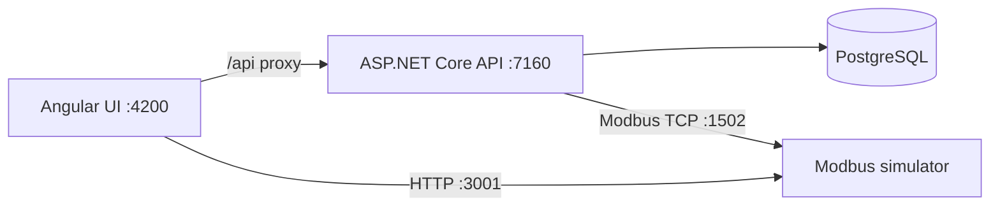

# Industrial IoT Monitoring

An end-to-end industrial IoT monitoring MVP built with ASP.NET Core, Angular,
PostgreSQL, and Modbus TCP. It models devices and sensors, polls live register
values, stores time-series measurements, raises threshold alerts, and sends
queued write commands back to devices.

> This is a learning and portfolio project. The authentication model and
> background workers are suitable for local development, not production use.

## Academic context

This project was originally developed as part of a university thesis-related
project exploring industrial IoT monitoring, Modbus TCP communication,
time-series measurements, alerting, and remote device commands. It has since
been prepared as a standalone portfolio and learning project.

This repository contains the software implementation, not the submitted thesis
document, and is not an official publication of the university.

## Features

- Device and sensor management with Modbus TCP configuration
- Periodic polling of holding registers and persisted measurements
- Sensor charts powered by Chart.js
- Automatic warning and critical alerts when values cross configured bounds
- Alert acknowledgement and clearing
- Queued Modbus write commands with retry, backoff, and stale-command recovery
- JWT login with `Operator`-protected mutations and configured `Operator` and
  `Viewer` demo users
- Swagger/OpenAPI documentation
- Development Modbus TCP and HTTP simulator

## Architecture



The backend follows a layered structure:

- `IndustrialIoT.Domain` — device, sensor, measurement, alert, and command entities
- `IndustrialIoT.Contracts` — API request and response models
- `IndustrialIoT.Application` — application service interfaces
- `IndustrialIoT.Infrastructure` — Entity Framework Core, PostgreSQL, migrations,
  seeding, and service implementations
- `IndustrialIoT.Web` — controllers, JWT authentication, Swagger, and hosted workers

## Technology stack

| Area | Technology |
| --- | --- |
| API | ASP.NET Core 9, C# |
| Data | Entity Framework Core 9, PostgreSQL |
| Device communication | NModbus, Modbus TCP |
| Frontend | Angular 19, TypeScript, Angular CDK |
| Charts | Chart.js, ng2-charts |
| Simulator | Node.js, Express, modbus-serial |
| Authentication | JWT bearer tokens |

## Prerequisites

- .NET 9 SDK
- PostgreSQL
- Node.js 22 LTS and npm
- A modern web browser

On macOS or Windows, trust the ASP.NET Core development certificate if needed:

```bash
dotnet dev-certs https --trust
```

## Quick start

### 1. Clone the repository

```bash
git clone https://github.com/oleksandrtarasov/Industrial-IoT-Monitoring.git
cd Industrial-IoT-Monitoring
```

### 2. Create a PostgreSQL database

Create an empty database and a user that owns it. The application applies its
Entity Framework migrations automatically at startup.

Keep the connection string and authentication credentials outside source
control with ASP.NET Core User Secrets:

```bash
dotnet user-secrets set \
  "ConnectionStrings:Default" \
  "Host=localhost;Port=5432;Database=<database>;Username=<user>;Password=<password>" \
  --project IndustrialIoT.Web

dotnet user-secrets set \
  "Jwt:Key" \
  "$(openssl rand -base64 48)" \
  --project IndustrialIoT.Web

dotnet user-secrets set \
  "Jwt:DemoUsers:0:Password" \
  "<operator-password>" \
  --project IndustrialIoT.Web

dotnet user-secrets set \
  "Jwt:DemoUsers:1:Password" \
  "<viewer-password>" \
  --project IndustrialIoT.Web
```

The configured demo usernames are `operator` and `viewer`. Passwords are local
secrets and are never stored in the repository.

### 3. Start the API

```bash
dotnet restore
dotnet run --project IndustrialIoT.Web
```

Development endpoints:

- API: `https://localhost:7160`
- Swagger UI: `https://localhost:7160/swagger`

On its first successful startup, the API applies database migrations and adds a
sample `Boiler-01` device with a temperature sensor.

### 4. Start the Modbus simulator

In another terminal:

```bash
cd modbus-simulator
npm ci
npm start
```

The simulator is reachable locally at:

- Modbus TCP on `127.0.0.1:1502`, unit ID `1`
- Register helper API on `http://127.0.0.1:3001`
- Holding registers `0` and `1`, initially set to `250` and `300`

The current simulator binds both services to all network interfaces and enables
unrestricted CORS. Run it only on a trusted development machine and do not expose
ports `1502` or `3001` to an untrusted network.

For a simulated sensor, configure its device with IP `127.0.0.1`, port `1502`,
and unit ID `1`. Assign register address `0` or `1`; use scale `0.1` to interpret
the initial values as `25.0` or `30.0`.

### 5. Start the Angular frontend

In another terminal:

```bash
cd industrial-iot-frontend
npm ci
npm start
```

Open `http://localhost:4200`. The Angular development server proxies `/api`
requests to the HTTPS backend.

## API overview

| Route group | Purpose |
| --- | --- |
| `/api/Auth` | Demo-user login and JWT issuance |
| `/api/Devices` | Device CRUD, summaries, and detailed views |
| `/api/Sensors` | Sensor CRUD |
| `/api/Measurements` | Record and query sensor measurements |
| `/api/Alerts` | Query, acknowledge, and clear alerts |
| `/api/Commands` | Queue, inspect, retry, and page device commands |

Read endpoints are currently anonymous. Creating, updating, or deleting devices
and sensors; queuing or retrying commands; and acknowledging or clearing alerts
require an `Operator` token. Measurement recording is currently anonymous. The
configured `viewer` account can obtain a JWT, but no endpoint currently requires
the `Viewer` role.

Use `/api/Auth/login` to obtain an operator token. In Swagger, select
**Authorize** and enter the raw JWT; Swagger adds the `Bearer` prefix:

```text
<token>
```

## Background processing

Two hosted services run with the API:

- `ModbusPollingService` groups configured sensors by device, reads one holding
  register per sensor, applies the scale, and records the measurement.
- `CommandExecutorHostedService` processes queued commands in FIFO order,
  executes Modbus writes, retries failures with linear backoff, and
  recovers commands left in the executing state after a timeout.

Polling and command execution settings live in `appsettings.json` and
`appsettings.Development.json`. Secrets belong in User Secrets for development
or in the deployment platform's secret manager for production.

## Useful commands

Build the backend:

```bash
dotnet build IndustrialIoT.sln
```

Build and test the frontend:

```bash
cd industrial-iot-frontend
npm run build
npm test -- --watch=false
```

Inspect which local secret keys are configured:

```bash
dotnet user-secrets list --project IndustrialIoT.Web
```

This last command prints secret values as well as their keys; do not share its
output.

## Project status and limitations

- Demo users are configuration-based; there is no user database or password hashing.
- Read endpoints and measurement recording are currently anonymous.
- JWTs are stored in browser local storage by the frontend.
- The simulator has no authentication and listens on all network interfaces.
- The command worker assumes a single API instance and does not claim work atomically.
- Modbus polling currently reads one holding register at a time.
- Production deployment, secret management, observability, and resilience need
  additional hardening.
